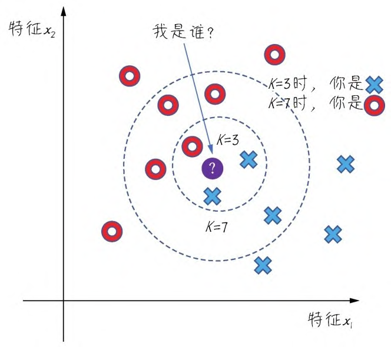

## HDF5

**后缀名**：`.h5` 或 `.hdf5`

这是一种常见的模型保存格式，可以存储模型的权重、结构和配置。
在 <ins>TensorFlow</ins> 和 <ins>Keras</ins> 中，可以使用 `model.save('model.h5')` 来保存模型为 HDF5 格式。

具体参考：[HDF5 数据文件简介 - 知乎](https://zhuanlan.zhihu.com/p/104145585)

---

## K最近邻算法（KNN）

是（K-Nearest Neighbor）的缩写，意为「K个最近的邻居」。它的思路就是**随大流**：对于一个待分类的数据样本，算法会找出与它距离最近的几个样本，也就是邻居，再看这些邻居的标签。如果邻居中大多数属于某一类，它就判定自己也属于这一类。参数 K 即邻居的个数，通常取 3、5、7 等不超过 20 的数字。

---
